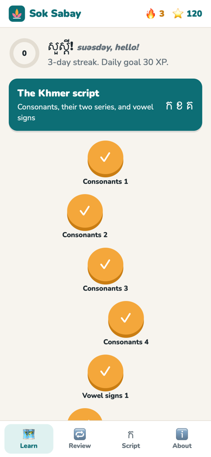
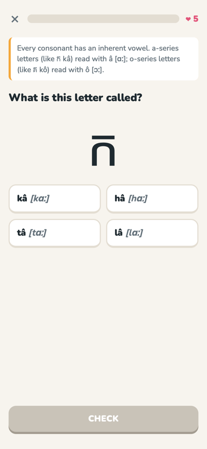
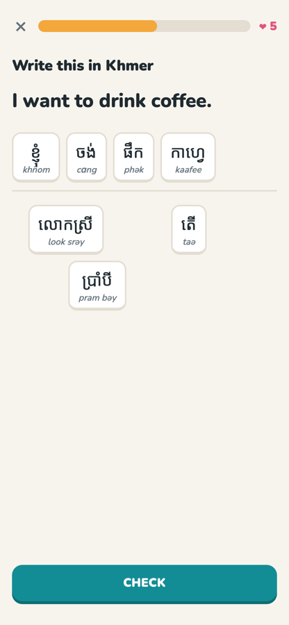

# Sok Sabay · សុខសប្បាយ

**Learn Khmer (Cambodian) in short daily lessons.** Live at **https://cveenstra.github.io/sok_sabay/**

The app has a path of units and lessons, XP, a daily streak, five hearts per lesson, and review mode that brings back the words you missed. It runs entirely in the browser. There is no account, and progress stays on your device.

<p>
  
  
  
</p>

## What's in it

**8 units, 36 lessons, 217 words and phrases, and 31 sentences.**

| Unit | Covers |
|---|---|
| The Khmer script | All 33 consonants with their a-/o-series, 16 dependent vowel signs |
| Greetings & politeness | Hello and goodbye (casual and formal), thank you, sorry, yes (men's and women's), address forms (បង, ប្អូន, លោក, លោកស្រី, ពូ, មីង), the sampeah, "How are you?" |
| Numbers | Khmer digits ០–៩, 0–10, tens, hundred and thousand, compound numbers |
| Food & market | Rice, meat, drinks, fruit, tastes, buying, prices, "How much?" |
| Family & people | Parents, siblings by age, grandparents, friends, pronouns |
| Time & days | Today, yesterday, tomorrow, parts of the day, clock words, the seven days |
| Getting around | Left, right, places, Phnom Penh, Siem Reap, Angkor Wat, transport |
| Everyday sentences | Common verbs, describing words, questions, negation (មិន … ទេ), "Do you speak English?" |

**Exercise types:**
- What does this mean? (Khmer → English)
- Pick the Khmer (English → Khmer)
- Choose the romanisation
- Match the pairs
- Build a sentence from word tiles
- Name the letter, pick the letter, and choose a letter's series
- Read a vowel sign
- Read a Khmer numeral
- **Review:** missed cards come back first, Leitner style, then at 1, 3, 7 and 16 days.

**Audio:** the 🔊 buttons use the browser's own Khmer (km-KH) text-to-speech voice when one exists. On most desktops there is none, so the buttons stay hidden. No recordings are bundled.

## Accuracy

- Every word was checked against its English Wiktionary entry, and the romanisation shown is Wiktionary's WT romanisation for that spelling.
- The alphabet, vowels and numerals come from Wikipedia's Khmer script and numerals articles.
- Sentence patterns follow the Khmer language article's grammar section.
- Sentences I composed from those patterns are labelled as composed.

[SOURCES.md](SOURCES.md) lists every source and what was left out. Corrections from Khmer speakers are very welcome: please [open an issue](https://github.com/cveenstra/sok_sabay/issues).

## Develop

It's a static site with no build step: plain HTML, ES modules and JSON.

```sh
python3 -m http.server 8000      # then open http://localhost:8000
node scripts/check-data.mjs      # validates the course data (also runs in CI)
```

- **`data/items.json`:** words, with Khmer, WT romanisation, English, category and source.
- **`data/sentences.json`:** sentences as lists of item ids.
- **`data/script.json`:** consonants, vowel signs and digits.
- **`data/course.json`:** units and lessons.
- **`js/engine.js`:** turns a lesson into questions.
- **`js/storage.js`:** progress, streak and spaced repetition, all guarded so the app works without localStorage.

**The data check enforces:**
- Every item has Khmer, romanisation and English.
- Khmer fields contain only Khmer Unicode.
- Ids are unique.
- Every lesson and sentence reference resolves.
- There are 33 consonants, and each one's series matches its UNGEGN name.
- Digits are the right code points, and number words match their digits.

## License

The code is MIT. The course data is adapted from Wiktionary and Wikipedia under [CC BY-SA 4.0](https://creativecommons.org/licenses/by-sa/4.0/). See [LICENSE](LICENSE) and [SOURCES.md](SOURCES.md).
