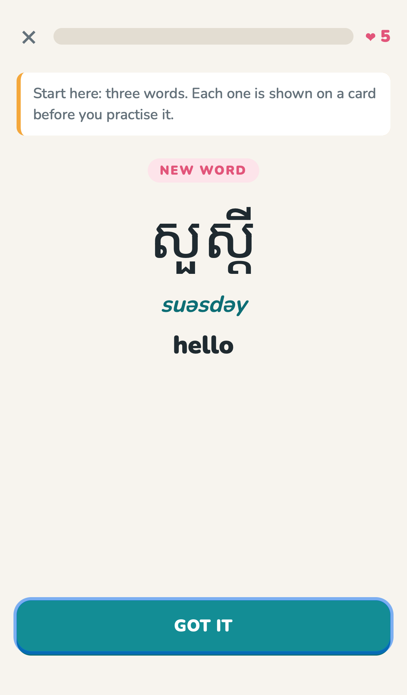
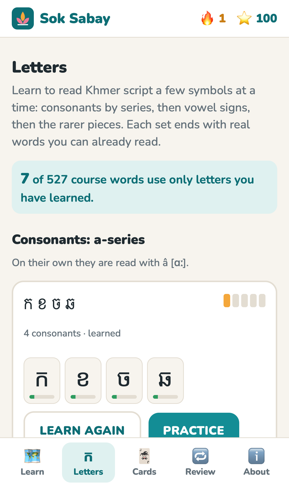
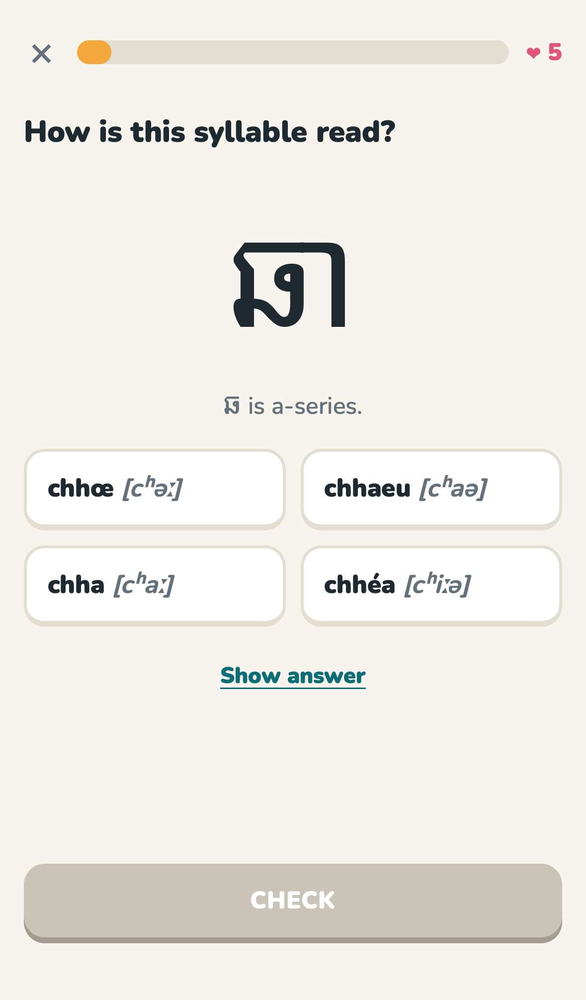

# Sok Sabay · សុខសប្បាយ

**Learn Khmer (Cambodian) in short daily lessons.** Live at **https://cveenstra.github.io/sok_sabay/**

The app has a path of units and small lessons, a Letters course for the script, flashcards, XP, a daily streak, five hearts per lesson, and a review mode that brings back what you missed. It runs entirely in the browser. On GitHub Pages progress stays on your device; when the app runs as a claude.ai artifact it is also saved to the viewer's account, so it follows them between phone and desktop.

<p>
  
  
  
</p>

## What's in it

**18 units, 159 lessons, 527 words and phrases, 58 sentences, and a 25-set Letters course.**

**An easy on-ramp.** Every lesson introduces at most four new words (the first lesson, three). Each new word or letter is shown on a card first: Khmer, romanisation, English and audio where available. Then it is practised three ways and mixed with words from earlier lessons. Every question has a **Show answer** link: it flips to the answer and costs no heart, and the word comes back later in Review. In sentences you can tap any Khmer word for its reading and meaning, and the sentence builder can show each tile's meaning.

| Unit | Covers |
|---|---|
| Hello! | Hello, thank you, sorry, yes (men's and women's), respectful greetings, the sampeah, "How are you?" |
| You & me | I and you, family words used as "you", other people, who and what |
| Numbers | Khmer digits ០–៩, 0–10, tens, hundreds to a million, building numbers |
| Food & drink | Rice, meat, fruit, drinks, the kitchen, dishes, tastes, hungry and full |
| Shopping | The market, prices, bargaining, the shop |
| Colours & clothes | Ten colours, clothes and sizes |
| Family | Parents, siblings by age, grandparents |
| Body & health | Head to toe, feeling sick, the doctor and pharmacy |
| Time | Today and tomorrow, times of day, the clock, days, months |
| Weather & nature | Rain and wind, sun and stars, hot and cold, rivers, mountains, rice fields |
| Getting around | Directions, places, Cambodia, transport, travel |
| At home | Rooms, things, plates and chopsticks |
| Animals | Farm and wild animals |
| Work & school | Jobs, the office, the classroom, languages |
| Feelings | Glad, worried, tired, heart and mind, smile and cry |
| Little words | Question words, this and that, and/or/but, not/already/will |
| Everyday verbs | Want and know, talking, doing, moving, daily life |
| Describing things | Big and small, new and old, easy and hard, how much |

Each unit ends with a unit practice and has a flashcard deck.

**Letters**, in the style of Duolingo's letters course: 25 small sets, each with intro cards, then letter to sound, sound to letter, which series, consonant plus vowel to syllable (and how the series changes the vowel), and finally real course words made only of letters already learned. Every symbol has a strength meter, and each set has Practice and Flashcards buttons.
- Consonants by series: a-series (4 sets), then o-series (5 sets)
- Dependent vowel signs (4 sets), vowels with ំ and ះ (2 sets)
- Marks such as ់ ៉ ៊ ៍ ៌ (2 sets), independent vowels (3 sets)
- Subscript consonants (3 sets, the 15 most common in course words), numerals (2 sets)

**Exercise types:** Khmer → English, English → Khmer, choose the romanisation, match pairs, build a sentence, what does this sentence mean (with tap-for-meaning), read a word you can now spell out, name the letter, pick the letter, which series, read a vowel sign, pick the vowel sign, read a syllable, same vowel / different series, vowels with ំ and ះ, independent vowels both ways, what a mark does, which letter a subscript belongs to, numerals.

**Review and flashcards:** missed and peeked cards come back first, Leitner style, then at 1, 3, 7 and 16 days. Flashcards flip to the answer and grade with Again / Got it, feeding the same schedule.

**Audio:** the 🔊 buttons use the browser's own Khmer (km-KH) text-to-speech voice when one exists. On most desktops there is none, so the buttons stay hidden. No recordings are bundled.

## Accuracy

- Every word was checked against its English Wiktionary entry, and the romanisation shown is Wiktionary's WT romanisation for that spelling.
- The alphabet, vowels and numerals come from Wikipedia's Khmer script and numerals articles.
- Sentence patterns follow the Khmer language article's grammar section.
- Sentences I composed from those patterns are labelled as composed.

[SOURCES.md](SOURCES.md) lists every source and what was left out. Corrections from Khmer speakers are very welcome: please [open an issue](https://github.com/cveenstra/sok_sabay/issues).

## Develop

It's a static site with no build step: plain HTML, ES modules and JSON.

```sh
python3 -m http.server 8000           # then open http://localhost:8000
python3 scripts/build_data.py         # rebuilds data/*.json from the verified sources
node scripts/check-data.mjs           # validates the course data (also runs in CI)
node scripts/check-questions.mjs      # generates every lesson and checks every question (also in CI)
python3 scripts/build_artifact.py out # packages the app as a claude.ai artifact page + files
```

- **`data/items.json`**, **`sentences.json`**, **`course.json`**: words, sentences (as item ids), and units of lessons.
- **`data/script.json`**: consonants with subscripts, vowel signs, vowels with ំ/ះ, independent vowels, marks and digits.
- **`data/letters.json`**: the Letters course.
- **`js/engine.js`**: turns a lesson, letters set, deck or review into questions.
- **`js/storage.js`**: progress, streak and spaced repetition, all guarded so the app works without localStorage.
- **`js/cloud.js`**: account sync when running as a claude.ai artifact (merges device and account progress, never loses lessons or cards).
- **`scripts/fetch_wiktionary.py`**, **`parse_script_extra.py`**: re-run the source checks.

**The checks enforce:** every item has Khmer, romanisation and English; Khmer fields contain only Khmer Unicode; ids are unique; every reference resolves; 33 consonants whose series matches their UNGEGN name; digits are the right code points; no lesson introduces more than four words (three in the first); every letter is taught exactly once; every generated question contains its right answer, and the right answer is not usually the longest option.

## License

The code is MIT. The course data is adapted from Wiktionary and Wikipedia under [CC BY-SA 4.0](https://creativecommons.org/licenses/by-sa/4.0/). See [LICENSE](LICENSE) and [SOURCES.md](SOURCES.md).
